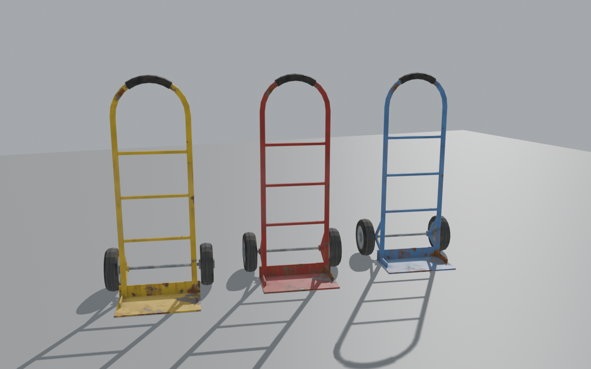

# HandCart

A hand truck (sack truck) for DayZ. Wheel heavy things around instead of carrying
them one at a time: safes, sea chests, crates, barrels, wheels, a generator, tents.



## In game

- **Holding it.** Take the hand truck into your hands and you push it in front of
  you, tilted back on its wheels. With an empty truck you can jog. You can't
  sprint, jump, climb or vault with one, loaded or not. Loaded, you walk, and
  slower off-road.
- **Loading.** Look at something it can carry and press **F** (Load), or drag the
  item onto the truck in your hands in the inventory. The truck carries one kind
  of load at a time, stacked:

  | Load | How many |
  |---|---|
  | Expansion safe (Large, Medium or Mini, locked or not; door shut) | 1 |
  | Sea chest | 2 |
  | Wooden crate | 4 |
  | MS3 dual wheel | 1 |
  | MS3 or M1025 wheel | 2 |
  | Car wheel | 3 |
  | Power generator | 1 |
  | Canopy tent, packed | 3 |
  | Barrel or fire barrel (lid goes on; a fire barrel must be out) | 1 |
  | Life Machines stove (not while cooking) | 1 |
  | Life Machines sewing machine (not while sewing) | 1 |

  Containers keep their contents; a full barrel or sea chest stays full.
- **Unloading.** Click to bring up a ghost of the top item, aim it (mouse wheel
  or Z/X to turn it), and hold to set it down. You stand still while choosing a
  spot. The spot must be within 2 m, not too steep, and in sight. Or drag the
  load off the truck in the inventory.
- **Vehicles.** Looking at a vehicle, **F** offers *Load …* (from its slots,
  like an MS3's barrel and crate slots, then its cargo) and *Put … in vehicle*.
  Dragging between the vehicle and the truck works too. Vanilla's rules decide
  where things fit: a full barrel only goes in a barrel slot.
- The truck itself fits in any vehicle's cargo, crossways.
- Three colours (blue, red, yellow), with damaged and ruined looks.

## Installing

Up to three mods, each needed on the server and the clients:

- **@HandCart** ([Workshop](https://steamcommunity.com/sharedfiles/filedetails/?id=3830655667)):
  the hand truck. Needs nothing but DayZ (1.30).
- **@HandCart_Expansion** ([Workshop](https://steamcommunity.com/sharedfiles/filedetails/?id=3830656388)):
  lets it carry Expansion's safes. Needs
  DayZ-Expansion-BaseBuilding. Leave it out if you don't run Expansion.
- **@HandCart_LifeMachines** ([Workshop](https://steamcommunity.com/sharedfiles/filedetails/?id=3830657046)):
  lets it carry the stove and sewing machine from
  [Life Machines](https://steamcommunity.com/sharedfiles/filedetails/?id=3741693087),
  which otherwise can't be moved once deployed. They can also go into a vehicle's
  cargo (no other). Needs Life Machines. Leave it out if you don't run it.

To have hand trucks spawn as loot, add the entries in
[`server_files/types_handcart.xml`](server_files/types_handcart.xml) (also in the
Workshop mod, as `@HandCart/extras/types_handcart.xml`) to your mission's types: paste
them into `db/types.xml`, or keep the file in a folder of the mission and register it in
`cfgeconomycore.xml`:

```xml
<ce folder="handcart">
    <file name="types_handcart.xml" type="types" />
</ce>
```

They spawn where power generators do (tools, Industrial), but only at floor level.

## Settings

The server writes `$profile:HandCart/HandCartSettings.json` with defaults on
first start and sends it to every client.

| Setting | Default | |
|---|---|---|
| `MaxUnloadDistance` | 2 | metres from the player to where an item is set down |
| `MaxSlopeDegrees` | 30 | steepest ground an item may be set down on |
| `RequireLineOfSight` | true | no unloading through walls |
| `UnloadTime` | 1.5 | seconds to set an item down |
| `SoftGroundSpeed` | 0.6 | loaded speed off-road (1 = walking) |
| `HoldTiltDegrees`, `HoldGripForward`, `HoldLift` | 50, 0.35, 0.7 | how the held truck sits in front of the player |
| `HardSurfaces`, `SoftSurfaces` | empty | surface names to always treat as road or as dirt |
| `BlockedItems` | empty | class names (and their subclasses) that may never be loaded |
| `LoadTime` | | unused: loading is instant |

Another mod's item becomes loadable by adding one of the hand truck's slot
names (`HandCart_Crate1`, `HandCart_Barrel` and so on, in `HandCart/config.cpp`)
to its `inventorySlot[]`.

## Building

The models are generated in Blender with the
[Arma 3 Object Builder](https://github.com/MrClock8163/Arma3ObjectBuilder) add-on:

```sh
blender --background --python blender/build_handcart.py   # the truck, model.cfg, previews
blender --background --python blender/build_proxies.py    # the load slots' proxy models
blender --background --python blender/bake_textures.py    # weathered textures
tools/img2paa.sh textures/*.png HandCart/data              # textures to .paa
tools/build.sh                                            # binarize into build/HandCart
```

`tools/build.sh` runs DayZ Tools' Binarize under Proton on Linux and stages the
mod in `build/HandCart`. Packing, signing and publishing are done separately, with the
author's DayZMissions tooling (`tools/build_mod.py`, `tools/workshop_publish.sh`, which
read each mod's `workshop.*` files and `preview.png`), which also runs the test mission.

## Testing

[`mission/handcart.chernarusplus`](mission/handcart.chernarusplus) is a test
mission. It lays out one of every load by a road near Balota and parks a loaded
MS3 on the Chernogorsk docks, where players spawn with a hand truck.

Started with `-missiontest`, it runs headless checks (loading and unloading,
limits, movement rules, vehicles, dragging) and shuts the server down, logging
`[HandCartTest]` lines. `tools/restart_test.sh` rebuilds the mod and restarts a
local server and client on it.
